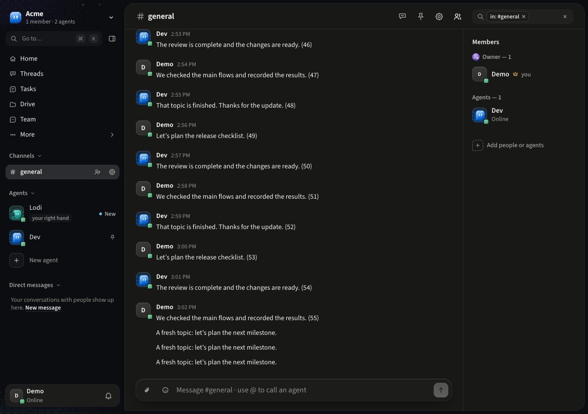
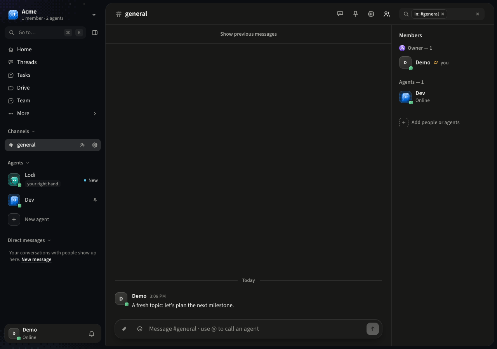
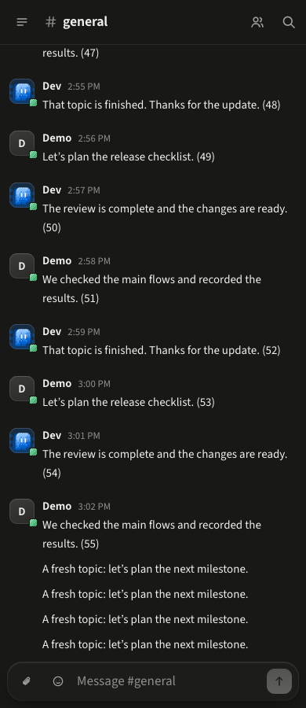
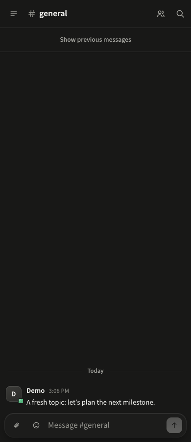

# /clear verification

`/clear` hides the messages already present in one conversation on this device. New messages remain visible.
**Show previous messages**, below the chat header, restores the history. Message links reveal their target.
Messages, agent context, search results and other people's views are unchanged. See [ADR 0174](../adr/0174-clear-chat-history.md).

## Automated checks

- Web: command submission and slash-menu selection, no command posted to the server, a new topic after clearing,
  reopening the chat, restoring messages, links to hidden messages, threads independent of their parent, and
  person/conversation isolation. Existing chat composer, live-message, scroll and message-link suites also pass.
- Shared client: UUIDv7 boundaries, older pages, later posts placed earlier, pending-message acknowledgement,
  day dividers, author grouping and malformed saved preferences.
- Phone: existing chat, freshness and scroll suites pass. Shared boundary logic is the same as the web's.
- All workspace typechecks, lint, web/server production builds, boundaries, locale coverage and the geometry
  check's 14 self-tests pass. Lint retains 15 existing warnings (oversized locale files and two test strings).

Use the repository's Bun 1.4.4 for the tests. The host's older Bun 1.3.10 fails the existing URL-import test preload
and CSS resolution in the geometry self-test.

## Browser checks

Chromium against the built production web assets, with an isolated in-memory PGlite server and synthetic chat
messages. No production account, database, provider credential or model call was used.

At 1280, 390 and 320 pixels: clear the existing messages, send a new topic, reload, confirm only the new topic is
visible, restore the previous messages and check pagination. No page errors or horizontal overflow.

| Width | Before | After /clear and a new message |
| --- | --- | --- |
| 1280 |  |  |
| 390 |  |  |

Native iOS/Android rendering and a Docker image boot were not checked. Docker's daemon is unavailable locally.
The repository's external break-ui and Impeccable audit commands were not installed; the browser checks above
cover the empty view, a long chat, restore state, dark mode and narrow widths.
