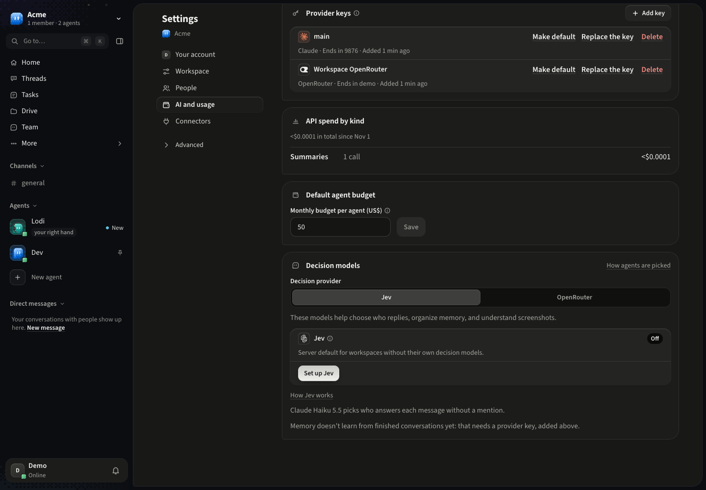
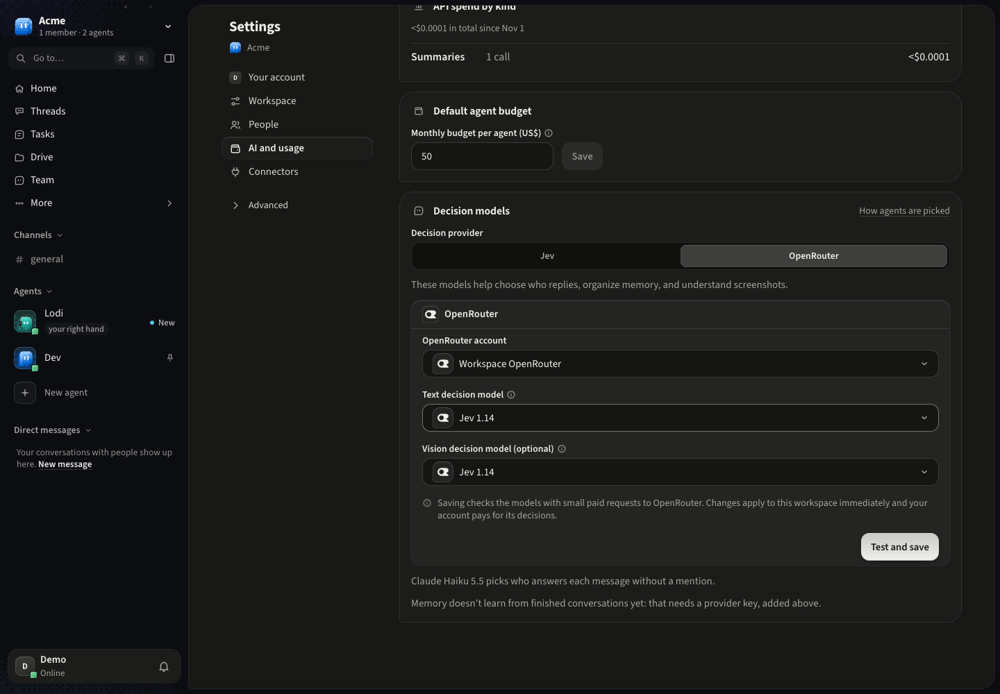
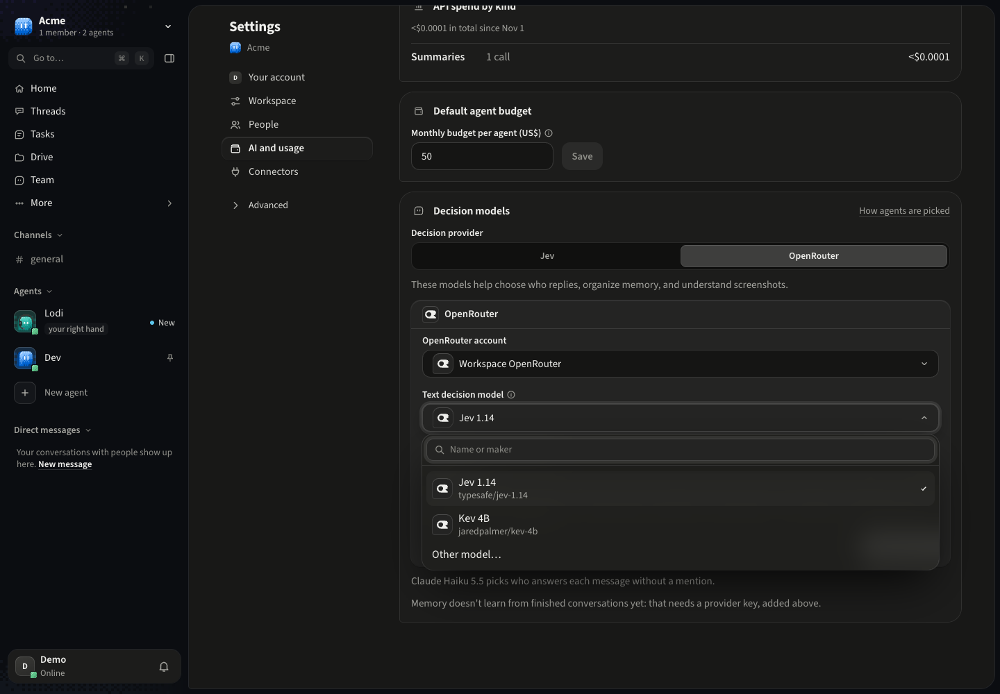
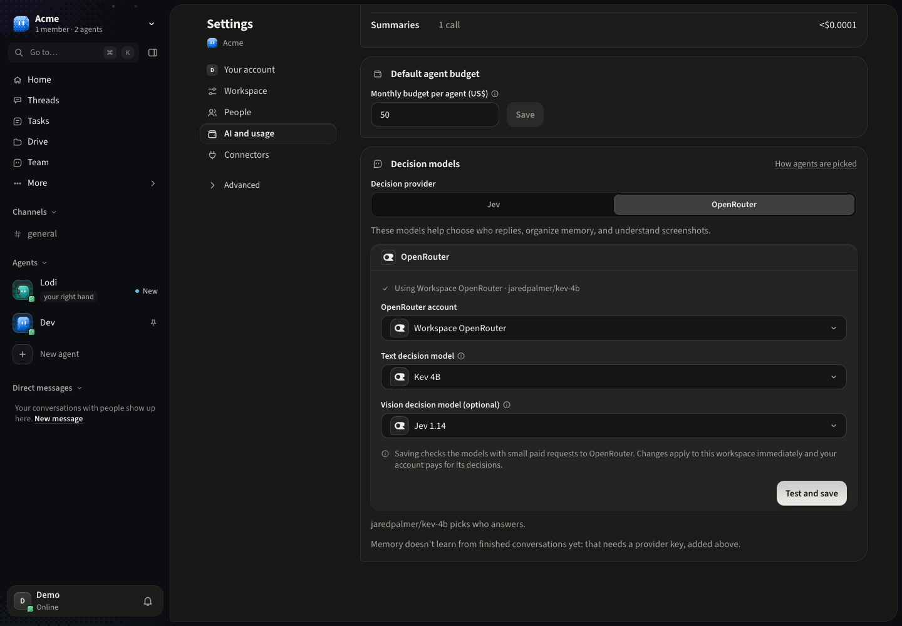
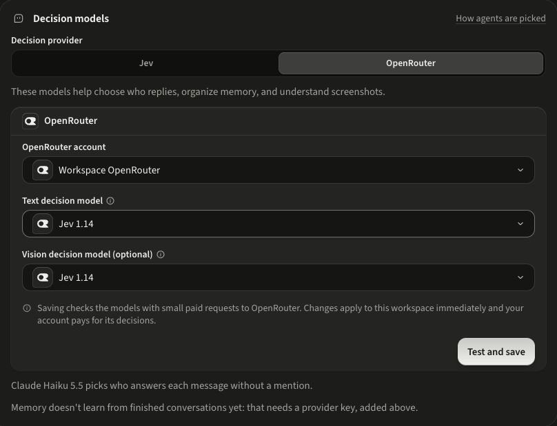
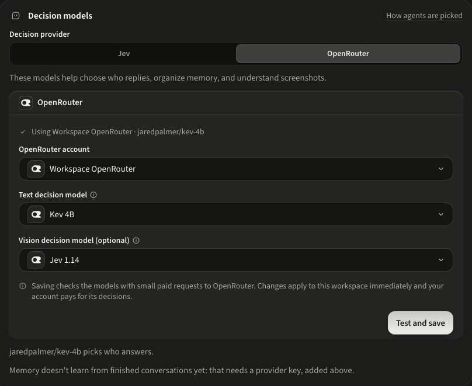
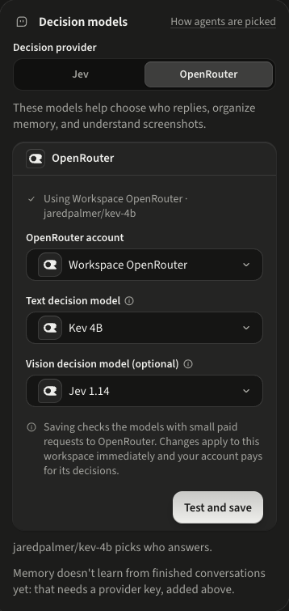

# OpenRouter decision models — UI verification

The feature was verified in a local workspace with synthetic accounts, an in-memory PGlite database
and fake OpenRouter responses. Screenshots show the real web app and backend routes. No production
workspace or real API key was used, and no paid provider call was made during development.

## Flow exercised in the browser

1. Open Settings → AI and usage → Decision models with an existing workspace OpenRouter account.
   Verify one section contains the provider choice, a shared explanation, connection settings, and
   the current routing status. The shared explanation appears for both Jev and OpenRouter.
2. Confirm **Jev** is selected by default and OpenRouter fields are collapsed. Choose **OpenRouter**
   to expand its branded provider card, account picker and model controls. Choose Jev or Kev for text,
   or choose **Other model…** and enter another compatible model ID. For vision, choose Jev, another
   compatible model through **Other model…**, or **Off** to disable image judgments. Verify the model
   picker supports search and keyboard selection.
3. Choose Test and save. Verify the selected account and model appear as active.
4. Reload the page and verify that selection persists.
5. Choose **Jev** to return to the server setup and verify the OpenRouter fields collapse.
   Confirm an unsaved draft survives switching views.
6. Check the same controls at a 390 px viewport. The form must remain readable with no horizontal overflow.

The browser run confirmed keyboard model selection, custom draft retention, persistence after reload,
no page errors and no horizontal overflow.
Automated tests cover account ownership, non-manager access, non-OpenRouter/revoked accounts, failed
capability tests and failed provider switches preserving settings, key rotation, calibration, image
requests, routing, billed cost and credential attribution, platform-cap separation, reset and the
existing TypeSafe path. UI tests also cover custom text and vision IDs, failed checks preserving
those drafts, and saved unlisted IDs remaining editable.

## Screenshots

### Full window — Jev selected

### Full window — OpenRouter expanded

The dark-theme views below include the workspace sidebar, Settings navigation and decision controls
at a 1440 × 1000 viewport, so the feature can be reviewed in the surrounding app.

### Full window — shared model picker

### Full window — saved selection

### Close-up — account selection

### Close-up — saved selection after reload

### Narrow viewport

## Limits of this verification

Provider behavior was simulated using the documented System One contract. Real model availability,
latency and probability calibration require evaluation with the chosen account and task data. The
local Docker daemon was unavailable, so the container boot check was not run.
